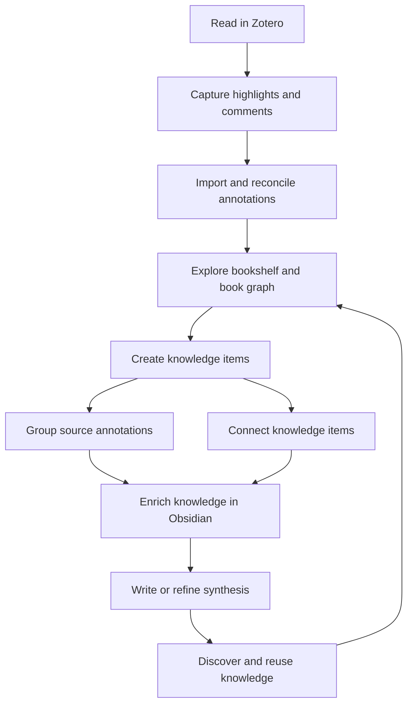
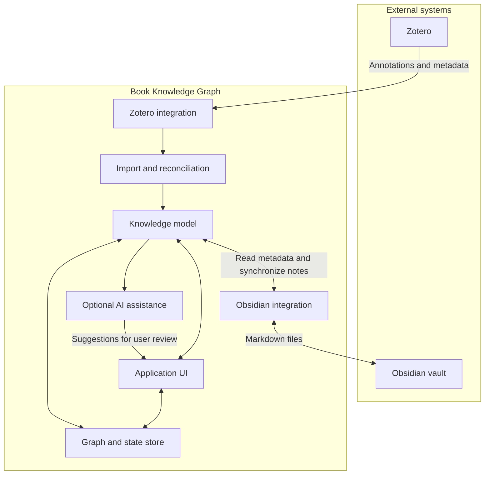
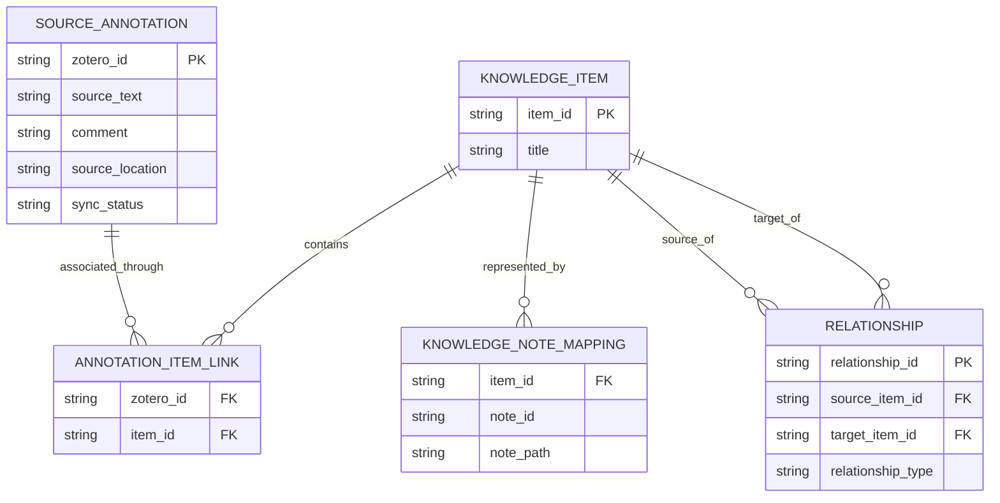
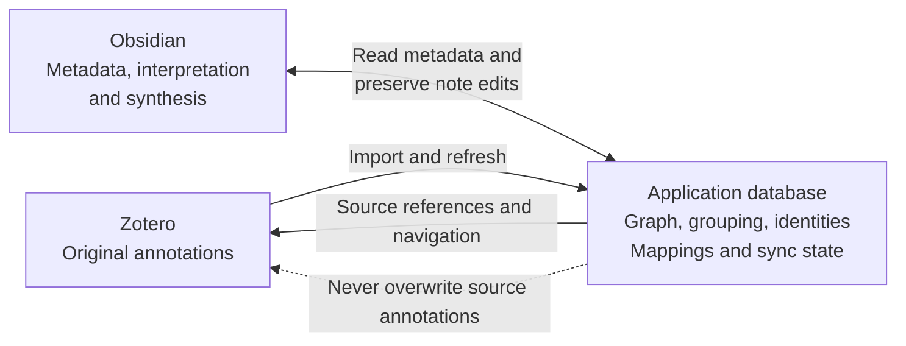
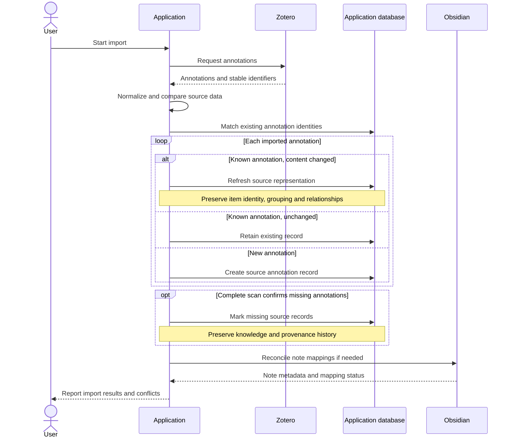
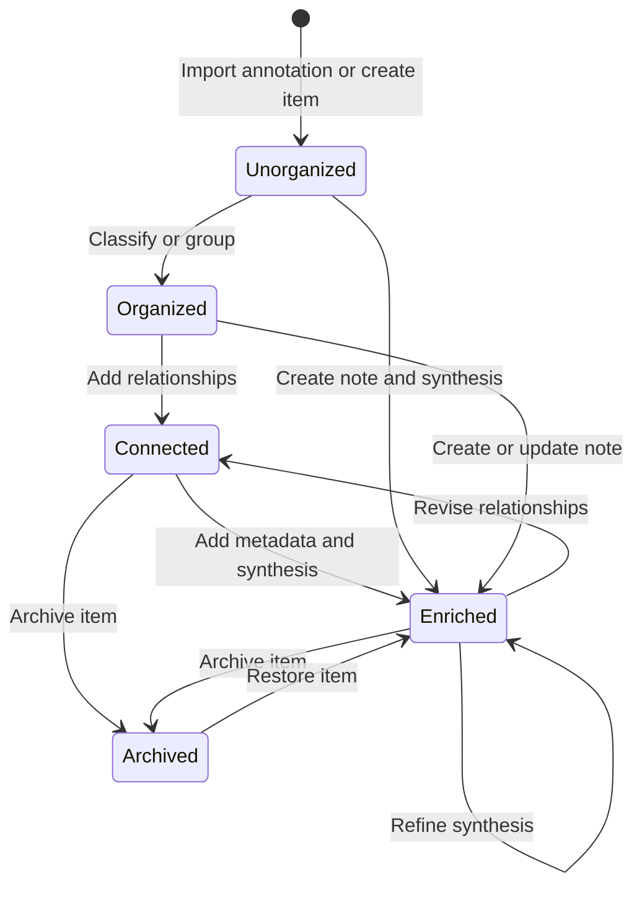
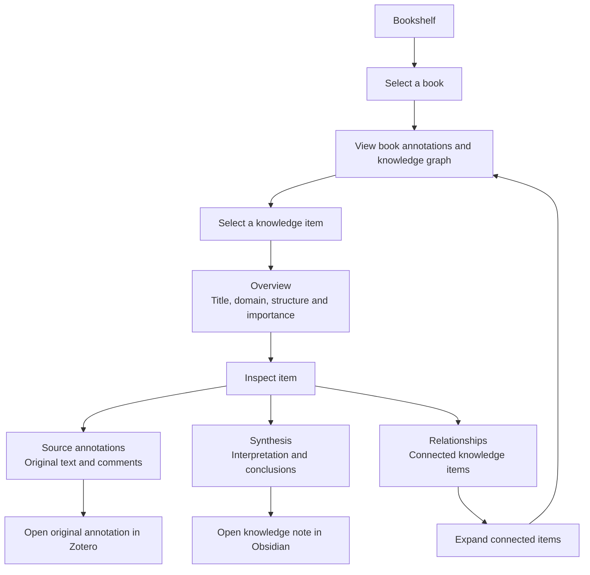
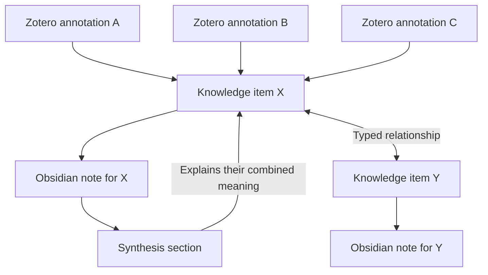

---
paras:
type:
subtypes:
rate:
tags:
status: inbox
maturity: capture
created: 2026-10-10 17:33
---
# [[Notes Spec]]

# Book Knowledge Graph — System Specification

## Product Definition

### Overview

Book Knowledge Graph is a knowledge-management application that transforms reading annotations into a structured, interconnected body of knowledge.

The system integrates Zotero as the source of reading annotations, an application-specific graph for organizing and navigating knowledge, and Obsidian as the destination for persistent knowledge notes and synthesis.

The central workflow is to capture passages and comments while reading, import them into the application, progressively organize them into knowledge items, establish relationships between ideas, and synthesize the resulting knowledge in Obsidian.

The system is designed to minimize friction during capture and organization. Users should be able to read a book once, capture relevant material as they go, and subsequently review, connect, and synthesize that material without having to reread the entire source.

The system does not attempt to replace Zotero, Obsidian, or their core functionality. Instead, it provides the missing layer between source annotations and a reusable knowledge base.

### Product Goals

- Transform raw reading annotations into structured, reusable knowledge.
- Preserve traceability from every extracted idea to its original source annotation.
- Support progressive refinement, from raw annotations to grouped knowledge items and synthesized notes.
- Make relationships between ideas discoverable through a visual graph.
- Support knowledge discovery across multiple books and external sources.
- Use Obsidian Markdown files as the persistent representation of personal knowledge.
- Keep the annotation capture process lightweight, avoiding mandatory classification during reading.
- Maintain a clear separation between source content, knowledge metadata, and graph structure.
- Support automation and AI-assisted organization without making AI output authoritative by default.
    

### Target Workflow

The primary workflow consists of the following stages.

**Capture**

The user reads in Zotero and creates highlights, annotations, and comments using Zotero's native capabilities. The application does not modify the original source annotations.

**Import**

The application parses the user's Zotero annotations and identifies new, updated, and missing annotations. Repeated imports reconcile the current source data with the application's stored representation.

**Explore**

The user opens a book from a bookshelf and explores its annotations and associated knowledge items. The user can inspect source material, discover relationships, and navigate between related ideas.

**Organize**

The user creates knowledge items from annotations, groups multiple annotations into one knowledge item, connects items through relationships, and enriches them with metadata.

**Synthesize**

The user creates or refines a synthesis of one or more annotations in an Obsidian note. Synthesis may be performed manually or assisted by AI, but the user remains in control of the resulting knowledge.

**Reuse**

The user discovers knowledge across books, follows graph relationships, opens the corresponding Obsidian notes, and returns to Zotero when the original context is needed.

### Core Domain Concepts

#### Source Annotation

A source annotation is an annotation created in Zotero.

It may contain highlighted text, a user comment, a page or location reference, and other source-specific metadata.

Each source annotation has an external identity derived from Zotero. The application preserves that identity and does not allow users to edit the original annotation's content or comments through the application.

A source annotation may be associated with a knowledge item without being modified.

#### Knowledge Item

A knowledge item is the fundamental conceptual entity represented in the graph.

It represents a piece of knowledge that can be explored, classified, related to other items, and represented in Obsidian.

Examples include a concept, a claim, a reasoning chain, a procedure, a piece of evidence, a reference, or an unresolved question.

A knowledge item has its own stable identity, independent of its source annotations and Obsidian file location.

A knowledge item may be backed by one or more source annotations. It may also exist without a source annotation, for example, when the user creates a question or an idea directly.

#### Annotation Grouping

Grouping is the operation of associating multiple source annotations with one knowledge item.

For example, three passages that collectively explain a concept can be represented as one knowledge item while retaining the identity and provenance of all three annotations.

Grouping does not delete, merge, or rewrite source annotations. It establishes a conceptual relationship between them and a knowledge item.

Grouping and synthesis are distinct: grouping defines which source material belongs to an item; synthesis expresses the meaning derived from that material.

#### Knowledge Note

A knowledge note is a Markdown document in Obsidian used to represent a knowledge item or multiple knowledge items.

In the initial implementation, each knowledge item has one primary Obsidian note. The underlying model must allow multiple knowledge items to be represented in a shared note later, without changing their identities.

A knowledge note may contain source references, metadata, user interpretations, questions, and a synthesis section.

The note is the persistent representation of the user's knowledge, not a replacement for the original source annotations.

#### Relationship

A relationship is a directed, typed connection between two knowledge items.

Examples include:

- Supports
    
- Explains
    
- Derives
    
- Contradicts
    
- Applies
    
- Exemplifies
    

Relationships belong to the application graph. They are not inferred merely because two items appear in the same Obsidian note or share a source annotation.

#### Question

A question is a knowledge item whose purpose is to express an unresolved issue.

Questions may originate from annotations or be created directly in the application. They have a resolution status and may be connected to the knowledge items that motivated them or eventually answer them.

A question is not a separate graph entity type: it is a knowledge item with question-specific semantics and status.

#### Synthesis

A synthesis is a section of an Obsidian note that expresses the user's consolidated understanding of the associated knowledge.

It may combine information from several annotations, explain relationships between ideas, or articulate a conclusion.

Synthesis is distinct from source content. It must not replace or silently overwrite the original Zotero material.

### Knowledge Classification

The system uses several independent dimensions to describe knowledge items.

**A — Knowledge structure**

Describes the conceptual role of an item. Suggested values are:

- Concept
    
- Claim
    
- Reasoning
    
- Procedure
    
- Evidence
    
- Reference
    

This classification is optional. It should be displayed on graph nodes but should not be mandatory during capture.

**B — Domain**

Describes the subject area of an item, such as Mathematics, Economics, Software, Physics, or History.

Domain is user-extensible and may be suggested automatically. It determines the primary color used to represent a node in the graph.

**C — Relationships**

Describes how two knowledge items relate to each other. It is represented by typed graph edges rather than as an isolated property of an annotation.

**Importance**

Importance is an independent property indicating the relative value of a knowledge item to the user. It is not equivalent to its knowledge structure or domain.

**Question status**

Question status indicates whether a question remains unresolved, has been partially resolved, or has been resolved.

These dimensions must remain independent. For example, a claim can belong to Economics, be highly important, and participate in several relationships.

### Product Scope

#### In Scope

- Importing and parsing annotations from Zotero.
    
- Incremental synchronization and reconciliation of source annotations.
    
- Identifying annotations through stable external identifiers.
    
- Managing knowledge items and their source provenance.
    
- Grouping multiple annotations into a single knowledge item.
    
- Creating and editing graph relationships.
    
- Maintaining graph-specific information in an application database.
    
- Exploring books and their associated knowledge through a bookshelf and graph interface.
    
- Classifying knowledge items and displaying classifications visually.
    
- Managing questions and their resolution status.
    
- Associating knowledge items with Obsidian Markdown notes.
    
- Reading and updating application-owned metadata in Obsidian notes.
    
- Creating and editing synthesis sections in Obsidian notes.
    
- Navigating from a knowledge item to its source annotations in Zotero.
    
- Navigating between related knowledge items and their Obsidian notes.
    
- Handling source changes, deleted annotations, synchronization failures, and unresolved mappings.
    
- Supporting optional AI assistance for classification, grouping suggestions, relationship suggestions, and synthesis.
    

#### Out of Scope

- Replacing Zotero's reading, highlighting, annotation, or reference-management functionality.
    
- Building a PDF or EPUB reader.
    
- Editing the original text, highlights, comments, or other user-authored source annotations in Zotero.
    
- Replacing Obsidian as the user's Markdown-based knowledge store.
    
- Implementing a general-purpose graph database or collaborative knowledge platform.
    
- Automatically guaranteeing a complete representation of a book from selective annotations.
    
- Requiring users to classify every annotation during reading.
    
- Automatically merging knowledge items or overwriting personal synthesis without user approval.
    
- Building a fully autonomous knowledge-management system in the initial release.
    

## Architecture

### Architectural Principles

**Clear ownership of data**

Every piece of information has one authoritative owner. The application must avoid maintaining independently editable copies of the same information across Zotero, its database, and Obsidian.

**Stable identities**

Source annotations, knowledge items, and Obsidian notes have distinct identities. Changes to content or file paths must not accidentally create new conceptual identities or break existing relationships.

**Source preservation**

The application treats Zotero annotations as externally managed source data. It may refresh its stored representation from Zotero but must not write changes back to the original annotations.

**Markdown as persistent knowledge**

Obsidian notes store the user's knowledge metadata and synthesis in a portable, inspectable format. The application database is reserved for structured application state, especially graph relationships and mappings that cannot be represented reliably as ordinary note content alone.

**Incremental processing**

The system must support repeated imports without duplicating existing annotations, losing graph relationships, or overwriting user-authored knowledge.

**Progressive disclosure**

The interface should initially present a concise representation of a knowledge item. Users can reveal its source annotations, comments, synthesis, and original source context when needed.

**Extensibility**

The architecture should allow additional classification values, graph visualizations, source types, automation capabilities, and shared-note support without requiring a fundamental redesign.

### High-Level Components

#### Zotero Integration

Responsible for obtaining annotations and relevant source metadata from Zotero.

Responsibilities:

- Access Zotero through an appropriate integration mechanism.
    
- Parse annotation content and metadata.
    
- Identify annotations using stable Zotero identifiers.
    
- Extract source locations and navigation information.
    
- Detect additions, modifications, and deletions where the integration mechanism permits.
    
- Report synchronization errors and ambiguous matches.
    
- Never modify the original source annotations.
    

The integration layer should isolate Zotero-specific formats and behavior from the core knowledge model.

#### Import and Reconciliation Service

Responsible for transforming parsed Zotero data into the application's canonical representation.

Responsibilities:

- Normalize source annotation data.
    
- Match incoming annotations to existing records.
    
- Detect source changes without confusing content changes with identity changes.
    
- Update cached source data while preserving knowledge items, graph edges, grouping, and personal enrichment.
    
- Track missing annotations and synchronization state.
    
- Prevent duplicate records during repeated imports.
    
- Provide recovery paths for failed or incomplete synchronization.
    

A content fingerprint may be used to detect changes, but must not be treated as the annotation's primary identity.

#### Knowledge Model

Responsible for the domain entities and their semantics.

Core entities:

- Source annotation
    
- Knowledge item
    
- Knowledge note mapping
    
- Relationship
    
- Annotation-to-item association
    
- Question status
    
- Domain and knowledge-structure classifications
    

The knowledge model defines identity, cardinality, validation rules, and permitted operations independently of the user interface and persistence implementation.

#### Graph Store

A local application database stores graph-specific state and other structured application state.

It is responsible for:

- Knowledge item identifiers and internal mappings.
    
- Typed relationships between knowledge items.
    
- Associations between source annotations and knowledge items.
    
- Group membership and other graph organization data.
    
- Graph layout and view preferences, if persistence is required.
    
- Synchronization and reconciliation state.
    
- References linking knowledge items to Obsidian notes.
    
- Cached or normalized source data when needed for performance.
    

The database must not become a competing authority for metadata that is intended to be owned by Obsidian.

#### Obsidian Integration

Responsible for representing and maintaining knowledge in Markdown files.

Responsibilities:

- Create a Markdown note for a knowledge item when needed.
    
- Associate notes with stable knowledge item identifiers.
    
- Store knowledge metadata, personal interpretation, and synthesis in the note.
    
- Read supported metadata back into the application.
    
- Resolve note links and file movements where possible.
    
- Preserve user-authored Markdown outside application-managed regions.
    
- Detect conflicts rather than silently overwriting external edits.
    

In the initial version, one knowledge item has one primary Obsidian note. Multiple items per note may be supported later through explicit item identifiers within the document.

#### Application Interface

Provides the user's primary workspace.

Responsibilities:

- Display the bookshelf and book details.
    
- Display annotations and knowledge items in a graph.
    
- Create, inspect, group, and connect knowledge items.
    
- Show the distinction between source material and user synthesis.
    
- Display domain colors, knowledge-structure markers, and relationship types.
    
- Support question management.
    
- Navigate to Obsidian notes and original Zotero sources.
    
- Expose synchronization status and conflict resolution when necessary.
    

The interface must not require the user to understand the underlying storage mechanisms.

#### Optional AI Assistance

AI capabilities are an optional service layer, not an authoritative source of truth.

Potential responsibilities:

- Suggest classifications.
    
- Suggest groups of related annotations.
    
- Propose relationships between knowledge items.
    
- Draft synthesis from selected annotations.
    
- Suggest questions or identify unresolved concepts.
    

AI-generated changes must be distinguishable from user-confirmed knowledge. The system must not silently overwrite source content or accepted user-authored synthesis.

### Data Ownership

|Data|Authoritative owner|Application behavior|
|---|---|---|
|Original highlighted text|Zotero|Import and display|
|Original annotation comments|Zotero|Import and display|
|Source location and annotation metadata|Zotero|Import and cache|
|Source annotation identifier|Zotero|Store as an external reference|
|Knowledge item identity|Application|Generate and preserve|
|Annotation-to-item association|Application database|Maintain and reconcile|
|Group membership|Application database|Maintain|
|Relationships between knowledge items|Application database|Maintain|
|Graph layout and view state|Application database|Maintain when persisted|
|Domain classification|Obsidian note|Read and display|
|Knowledge-structure classification|Obsidian note|Read and display|
|Importance|Obsidian note|Read and display|
|Question status|Obsidian note|Read and display|
|Personal interpretation|Obsidian note|Preserve|
|Synthesis|Obsidian note|Preserve|
|Knowledge item to note mapping|Application database, with a stable identifier in the note|Reconcile and validate|
|Parser cache and source fingerprints|Application database|Regenerate as needed|

If a value is copied into a cache or derived representation, that copy is not authoritative. The system must document which fields are application-managed and how updates propagate.

### Identity and Relationships

The architecture distinguishes three independent identities.

**Source annotation ID**

An external identifier supplied by Zotero. The implementation must verify its stability across normal annotation edits and document any limitations of the selected integration mechanism.

**Knowledge item ID**

An application-generated stable identifier. It remains unchanged when the item is renamed, reclassified, grouped with source annotations, or moved between Obsidian files.

**Obsidian note reference**

A reference to the Markdown representation of a knowledge item. It may use a file path or another resolvable note reference, but should also include a stable knowledge item identifier in the note to support file moves and reconciliation.

Relationships reference knowledge item IDs, not titles or file paths. This ensures that renaming a note does not break the graph.

A source annotation may be associated with a knowledge item. A knowledge item may be associated with multiple source annotations. In the initial implementation, a source annotation should belong to at most one active knowledge item unless a later requirement explicitly supports reuse of the same annotation across several items. If reuse is introduced, the model must distinguish membership from mere citation.

### Initial Persistence Model

The first implementation should use a local relational database with support for foreign keys and transactions.

A relational database is sufficient for the initial graph because the main operations involve retrieving a knowledge item's neighbors, listing a book's items, and updating typed relationships. A dedicated graph database is not required.

Suggested logical entities:

- `source_annotations`
    
- `knowledge_items`
    
- `annotation_item_links`
    
- `relationships`
    
- `knowledge_note_mappings`
    
- `sync_runs`
    
- `source_change_events` or equivalent reconciliation records
    

These names describe logical responsibilities, not a mandatory physical schema.

The database should enforce identity and referential-integrity constraints. Operations that modify grouping or relationships should be transactional where necessary.

### Obsidian Note Contract

Each generated note must be valid Markdown and remain useful outside the application.

A note should support:

- A stable knowledge item identifier.
    
- A human-readable title.
    
- Domain and knowledge-structure metadata.
    
- Importance and question status where applicable.
    
- References to one or more source annotations.
    
- A synthesis section.
    
- Personal interpretation and other user-authored content.
    

The implementation should define a documented metadata schema and clearly delimit any application-managed sections.

The application must preserve unknown metadata fields and user-authored content that it does not own. It must not regenerate an entire note from a template on every synchronization.

The exact frontmatter keys and the syntax used for source references are implementation decisions to finalize before implementation.

### Synchronization Model

Synchronization is reconciliation, not blind replacement.

For each import cycle:

- Retrieve the available source annotations.
    
- Match them using verified stable external identifiers.
    
- Update the cached source representation of matched annotations.
    
- Create records for newly discovered annotations.
    
- Mark previously known annotations as missing when absence is confirmed by a sufficiently complete source scan.
    
- Preserve knowledge item identities, grouping, relationships, and Obsidian content.
    
- Report conflicting or ambiguous mappings for review.
    
- Avoid treating a temporary API failure or incomplete scan as mass deletion.
    

A change in annotation text must not automatically create a new source identity if Zotero preserves the identifier. A deleted and recreated annotation may receive a new identifier and must be handled as a distinct source record unless the integration can establish a reliable replacement relationship.

Source deletion must not silently delete the associated knowledge item, its graph relationships, or its Obsidian note. Instead, the system should preserve the knowledge and mark the provenance as unavailable or missing.

### Navigation and Visualization

The bookshelf is the primary entry point.

A book view displays the annotations and knowledge items associated with that book. Users can expand the graph to discover items connected to other books or external sources.

Graph presentation:

- Node color represents domain.
    
- A visible marker represents knowledge structure.
    
- Edges represent typed relationships.
    
- Node size or another restrained visual property may represent importance.
    
- Questions have a distinguishable unresolved/resolved state.
    
- Grouped source annotations are represented by one knowledge item, with access to all underlying annotations.
    
- Graph layout and display preferences do not change the semantic identity of knowledge items.
    

Navigation should follow a progressive-disclosure model:

- **Overview:** title, concise summary, domain, and key graph connections.
    
- **Inspection:** source annotations, comments, synthesis, and relevant metadata.
    
- **Source:** open the corresponding annotation in Zotero when a reliable navigation target is available.
    

## Functional Requirements

### Annotation Import and Synchronization

**FR-01 — Zotero integration**

The system shall import annotations from a supported Zotero integration mechanism.

**FR-02 — Source annotation preservation**

The system shall treat Zotero as the authoritative source for original annotation text, comments, and source metadata.

**FR-03 — Read-only source interaction**

The application shall not provide functionality that modifies original Zotero annotations or their comments.

**FR-04 — Source identity**

The system shall identify imported annotations using a stable Zotero identifier where the integration exposes one. The implementation shall verify the identifier's behavior across normal edits and document any limitations.

**FR-05 — Incremental import**

The system shall support repeated imports without creating duplicate source annotation records for annotations already known to the system.

**FR-06 — Change detection**

The system shall detect changes in imported annotation content and metadata independently of the annotation's identity.

**FR-07 — Missing annotation detection**

The system shall detect annotations that are no longer present in Zotero when a complete source scan confirms their absence.

**FR-08 — Safe reconciliation**

The system shall preserve knowledge items, graph relationships, grouping, and Obsidian content when source annotations change or become unavailable.

**FR-09 — Incomplete synchronization protection**

The system shall not interpret a failed or incomplete import as confirmation that all unreturned annotations have been deleted.

**FR-10 — Synchronization diagnostics**

The system shall expose synchronization outcomes, including newly imported annotations, updated annotations, missing annotations, and errors.

**FR-11 — Ambiguous source matching**

When an annotation cannot be matched reliably, the system shall avoid silently merging it with an existing record and shall provide a recoverable resolution path.

**FR-12 — Parser isolation**

Zotero-specific parsing and normalization shall be isolated from the core knowledge model so that parser implementations can be replaced or extended without redefining the domain entities.

### Knowledge Item Management

**FR-13 — Stable knowledge identity**

Each knowledge item shall have a unique, stable identifier independent of its title, source annotations, and Obsidian file path.

**FR-14 — Independent item creation**

Users shall be able to create knowledge items without requiring a source annotation.

**FR-15 — Source association**

Users shall be able to associate one or more source annotations with a knowledge item.

**FR-16 — Annotation grouping**

Users shall be able to group multiple source annotations into a single knowledge item without merging or modifying the original annotations.

**FR-17 — Group preservation**

The system shall preserve the identity and provenance of every source annotation belonging to a grouped knowledge item.

**FR-18 — Group editing**

Users shall be able to modify group membership without losing source annotations or unrelated graph relationships.

**FR-19 — Independent identity and representation**

Changing a knowledge item's title, classification, grouping, or Obsidian file location shall not change its identity.

**FR-20 — Optional classification**

The system shall support optional knowledge-structure classification using the configured values, initially Concept, Claim, Reasoning, Procedure, Evidence, and Reference.

**FR-21 — Extensible domains**

The system shall support user-extensible domain classifications.

**FR-22 — Importance**

The system shall support an importance property independent of knowledge structure and domain.

**FR-23 — Questions**

The system shall support questions as knowledge items with a resolution status.

**FR-24 — Question lifecycle**

Users shall be able to create, update, partially resolve, and resolve questions without changing the identity of the question item.

### Graph Management

**FR-25 — Typed relationships**

Users shall be able to create and remove typed relationships between knowledge items.

**FR-26 — Relationship vocabulary**

The system shall initially support Supports, Explains, Derives, Contradicts, Applies, and Exemplifies, while allowing the vocabulary to be extended.

**FR-27 — Relationship integrity**

Relationships shall reference stable knowledge item identifiers and shall remain valid when titles or note paths change.

**FR-28 — Graph retrieval**

The system shall retrieve the relationships of a knowledge item and the connected items needed for graph exploration.

**FR-29 — Graph consistency**

The system shall prevent invalid relationships, including references to nonexistent items, and shall handle item deletion or archival without leaving unintended dangling references.

**FR-30 — Annotation and graph separation**

The system shall not infer that two knowledge items are identical merely because they share a source, appear in the same note, or have similar content.

### Obsidian Integration

**FR-31 — Knowledge note association**

Each knowledge item shall have one primary Obsidian note in the initial implementation.

**FR-32 — Note creation**

The system shall be able to create an Obsidian Markdown note for a knowledge item when requested or when the workflow requires it.

**FR-33 — Stable note mapping**

The system shall maintain a mapping between a knowledge item and its Obsidian note that does not rely solely on the note title.

**FR-34 — Metadata integration**

The system shall read and display supported knowledge metadata from Obsidian, including domain, knowledge structure, importance, and question status.

**FR-35 — Synthesis support**

The system shall support a synthesis section within a knowledge note.

**FR-36 — User content preservation**

The system shall preserve user-authored Markdown and metadata outside explicitly application-managed regions.

**FR-37 — Note reconciliation**

The system shall detect missing notes, moved notes, and conflicting edits where the integration can reliably identify them. It shall not silently overwrite user content to resolve a conflict.

**FR-38 — Shared-note extensibility**

The domain model shall allow multiple knowledge items to be represented in a shared Obsidian note in a future version without requiring the items to merge or change identity.

**FR-39 — Markdown portability**

Generated notes shall remain readable and useful as ordinary Markdown files without requiring the application to render their contents.

### Navigation and Exploration

**FR-40 — Bookshelf**

The system shall provide a bookshelf as the primary entry point for browsing imported books.

**FR-41 — Book-centric exploration**

Users shall be able to select a book and explore its source annotations and associated knowledge items.

**FR-42 — Cross-book discovery**

Users shall be able to discover connected knowledge items originating from other books or sources.

**FR-43 — Progressive disclosure**

The interface shall allow users to move from a concise knowledge-item overview to its underlying annotations and detailed synthesis.

**FR-44 — Source navigation**

The system shall provide a way to open the corresponding source annotation in Zotero when the necessary source navigation information is available.

**FR-45 — Obsidian navigation**

The system shall provide a way to open the associated knowledge note in Obsidian when the note is available.

**FR-46 — Provenance visibility**

Users shall be able to determine which source annotations support a knowledge item and access their source context.

**FR-47 — Group inspection**

Users shall be able to inspect all source annotations associated with a grouped knowledge item.

**FR-48 — Question discovery**

Users shall be able to identify unresolved questions and navigate between questions and their related knowledge items.

### Automation and AI Assistance

**FR-49 — Optional AI assistance**

AI-assisted classification, grouping, relationship suggestions, question generation, and synthesis shall be optional capabilities.

**FR-50 — User control**

The system shall distinguish proposed changes from confirmed changes and shall not silently accept suggestions that alter established knowledge organization.

**FR-51 — Source-grounded synthesis**

When generating synthesis from annotations, the system shall retain references to the source material used and shall not present generated interpretations as original source content.

**FR-52 — Non-destructive generation**

AI-assisted operations shall not overwrite original Zotero annotations or unrelated user-authored Obsidian content.

## User Experience Requirements

### Capture and Organization

**UX-01 — Low-friction capture**

The workflow shall not require users to classify annotations while reading in Zotero.

**UX-02 — Progressive enrichment**

Users shall be able to move from unclassified source material to enriched knowledge items incrementally.

**UX-03 — Minimal mandatory metadata**

The system shall require only the information necessary to perform an operation. Classification, importance, and synthesis shall remain optional unless required by a specific feature.

**UX-04 — Separate concepts from actions**

The interface shall distinguish grouping annotations, connecting knowledge items, and organizing items into notes.

**UX-05 — Non-destructive interaction**

Operations shall make clear whether they change source associations, graph relationships, metadata, or note content.

**UX-06 — Explicit destructive actions**

Operations that remove relationships, change group membership, or delete knowledge items shall make their consequences clear and avoid accidental loss of source material.

### Bookshelf and Graph

**UX-07 — Book-first navigation**

The bookshelf shall be the default entry point for exploring the knowledge derived from reading.

**UX-08 — Book context**

The selected book's annotations and knowledge items shall be accessible without requiring users to understand the complete graph first.

**UX-09 — Domain encoding**

Graph nodes shall use color to represent domain, with a consistent mapping between domain and color.

**UX-10 — Structure encoding**

Graph nodes shall display a visible marker for their knowledge structure.

**UX-11 — Relationship encoding**

Graph edges shall communicate the existence and, when useful, the type of a relationship without overwhelming the graph.

**UX-12 — Importance encoding**

Importance may influence node prominence, but shall not obscure domain or knowledge-structure indicators.

**UX-13 — Question visibility**

Unresolved questions shall be visually distinguishable from resolved questions.

**UX-14 — Group representation**

A knowledge item backed by multiple annotations shall be represented as one conceptual node, with a clear way to inspect its underlying annotations.

**UX-15 — Progressive disclosure**

Users shall initially see concise information and reveal detailed source material or synthesis when requested.

**UX-16 — Cross-book expansion**

Users shall be able to expand from a book's graph into connected items from other books without losing their original navigation context.

**UX-17 — Graph readability**

The visualization shall prioritize meaningful relationships and readable nodes over displaying every possible piece of metadata simultaneously.

### Provenance and Navigation

**UX-18 — Source traceability**

Users shall be able to distinguish original source material from their own interpretations and synthesized knowledge.

**UX-19 — Source navigation**

Users shall be able to open the original Zotero annotation from a knowledge item when supported by the source integration.

**UX-20 — Note navigation**

Users shall be able to open the associated Obsidian note without manually searching for its file.

**UX-21 — Missing-source feedback**

When an annotation or note is unavailable, the interface shall indicate the problem without implying that the associated knowledge has been deleted.

**UX-22 — Synchronization feedback**

The interface shall communicate synchronization failures and unresolved conflicts in a way that allows users to recover without losing work.

### Obsidian Editing Experience

**UX-23 — Native Markdown**

Generated notes shall remain editable using standard Obsidian functionality and readable in other Markdown editors.

**UX-24 — Predictable note structure**

Notes shall follow a documented structure so that source references, metadata, and synthesis are easy to locate.

**UX-25 — Preservation of user edits**

The application shall avoid surprising changes to note structure or content during synchronization.

**UX-26 — Distinct synthesis**

The synthesis section shall be clearly distinguishable from original source excerpts and comments.

**UX-27 — Metadata consistency**

Metadata displayed in the application shall reflect the authoritative values in Obsidian, subject to clearly communicated synchronization delays or conflicts.

## Non-Functional Requirements

**NFR-01 — Data integrity**

The system shall preserve stable identities and referential integrity across synchronization, grouping, relationship editing, and note reconciliation.

**NFR-02 — Non-destructive synchronization**

Import and synchronization shall never silently destroy knowledge items, relationships, synthesis, or user-authored note content.

**NFR-03 — Recoverability**

The system shall retain enough synchronization state and diagnostics to recover from interrupted imports and resolve ambiguous mappings.

**NFR-04 — Performance**

The system shall support interactive exploration of a user's normal reading-derived knowledge base without requiring a full re-import or full graph recomputation for every navigation action.

**NFR-05 — Modularity**

Zotero parsing, reconciliation, the knowledge model, graph persistence, Obsidian integration, and user-interface code shall be separated into replaceable components.

**NFR-06 — Portability**

Knowledge notes shall use standard Markdown and documented metadata conventions rather than relying on a proprietary document format.

**NFR-07 — Extensibility**

The system shall allow additional classification values, relationship types, source integrations, and visualization modes without requiring changes to the identity model.

**NFR-08 — Transparency**

The system shall make source provenance, synchronization status, and the ownership of editable data understandable to the user.

**NFR-09 — Consistency**

The system shall prevent stale or conflicting data from being silently presented as synchronized authoritative information.

**NFR-10 — Testability**

The core domain model and reconciliation logic shall be testable independently of Zotero, Obsidian, and the graph interface through controlled fixtures and simulated source changes.

## Acceptance Criteria

The initial release is considered functionally complete when the following scenarios can be demonstrated.

**AC-01 — Initial import**

Given a Zotero library containing annotations, importing them creates source annotation records without modifying Zotero.

**AC-02 — Repeated import**

Importing the same source data repeatedly does not create duplicate source annotations or knowledge items.

**AC-03 — Source edit**

When an existing Zotero annotation changes but retains its identifier, the cached source representation is updated while the associated knowledge item's identity, relationships, and synthesis remain intact.

**AC-04 — Source deletion**

When a source annotation is confirmed missing, the system preserves the knowledge item and marks its source provenance as unavailable rather than deleting the associated knowledge.

**AC-05 — Grouping**

Given several source annotations, the user can associate them with one knowledge item and inspect each original annotation independently.

**AC-06 — Graph relationships**

The user can connect knowledge items through typed relationships, and those relationships remain valid when item titles or Obsidian file paths change.

**AC-07 — Obsidian note creation**

Creating a knowledge note produces a valid Markdown file associated with the correct stable knowledge item identifier.

**AC-08 — Metadata round-trip**

Supported metadata edited in Obsidian is reflected in the application without creating a competing authoritative copy.

**AC-09 — Synthesis preservation**

Editing a synthesis section in Obsidian does not modify the source annotations and does not get overwritten by a routine source import.

**AC-10 — Source navigation**

The user can navigate from a knowledge item to its associated Zotero annotation when a valid source navigation target exists.

**AC-11 — Cross-book exploration**

The user can begin with one book and discover connected knowledge items originating from another book.

**AC-12 — Questions**

The user can create a question, connect it to relevant knowledge items, update its resolution status, and preserve it across synchronization.

**AC-13 — Synchronization failure**

An incomplete import does not cause unreturned annotations to be marked as deleted or remove existing graph data.

**AC-14 — Stable knowledge identity**

Renaming or moving a knowledge note does not create a new knowledge item or break its graph relationships when the note can be reliably reconciled.

## Open Design Decisions

The following decisions should be resolved during implementation planning rather than being treated as already settled.

### Zotero Integration Mechanism

Determine which Zotero API, local data access mechanism, or supported export format provides the required annotation identifiers, source locations, and change-detection capabilities.

Verify annotation identifier stability empirically and document limitations.

### Obsidian Metadata Contract

Define the exact frontmatter keys, stable ID format, source reference format, and boundaries of application-managed sections.

Specify how the application handles unknown metadata fields, note renames, missing notes, duplicate IDs, and concurrent edits.

### Annotation Reuse

The initial model assumes that a source annotation belongs to at most one active knowledge item. Decide whether future workflows should allow the same annotation to support multiple independent knowledge items, distinguishing membership from citation if needed.

### Shared Obsidian Notes

The first version uses one primary note per knowledge item. Determine whether real workflows justify supporting multiple knowledge items within a shared note and, if so, how each item is identified within that note.

### Graph Layout Persistence

Decide whether graph positions and view state are persisted per book, per graph view, or globally, and how these preferences behave when items are added or removed.

### Synchronization Direction

Define the exact synchronization behavior for metadata and synthesis edits made directly in Obsidian. The default is that Obsidian owns these fields, Zotero owns source annotations, and the application database owns graph relationships and mappings.

### AI Approval Model

Define which AI-assisted operations may be applied automatically, which require confirmation, and how generated content is distinguished from user-authored content.

### MVP Prioritization

A recommended minimum viable product includes Zotero import and reconciliation, stable knowledge identities, annotation grouping, typed graph relationships, one Obsidian note per knowledge item, source navigation, a bookshelf, and a basic graph explorer.

AI assistance, advanced graph layouts, automatic relationship discovery, and shared Obsidian notes can be introduced after the core data model and synchronization behavior are reliable.

## Diagrams

